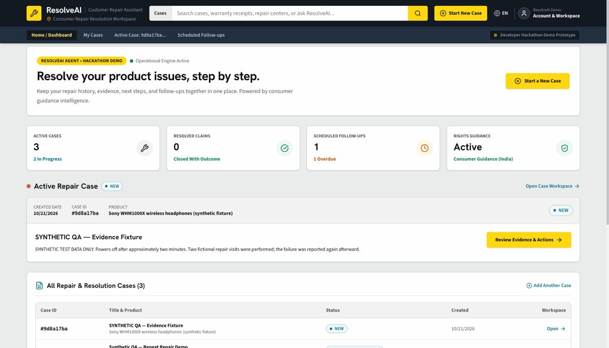
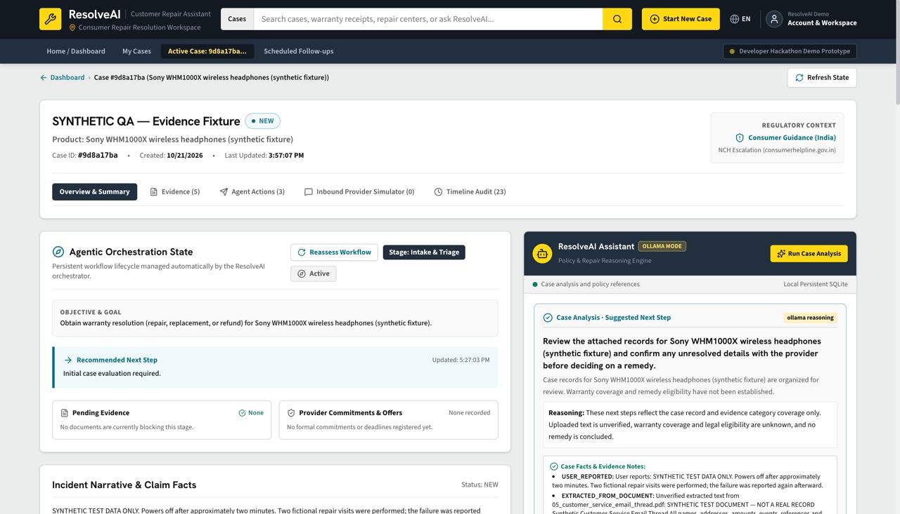
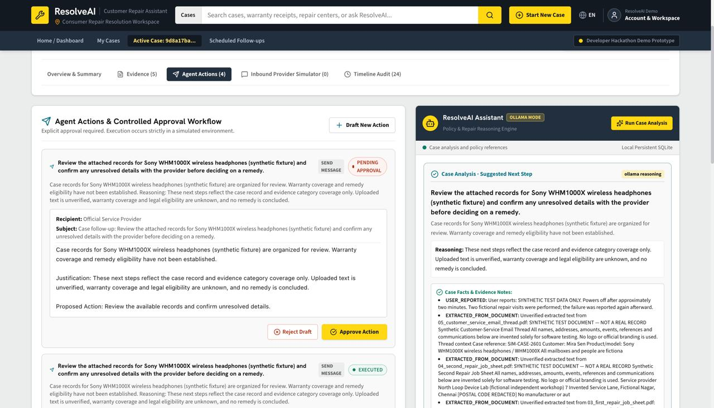
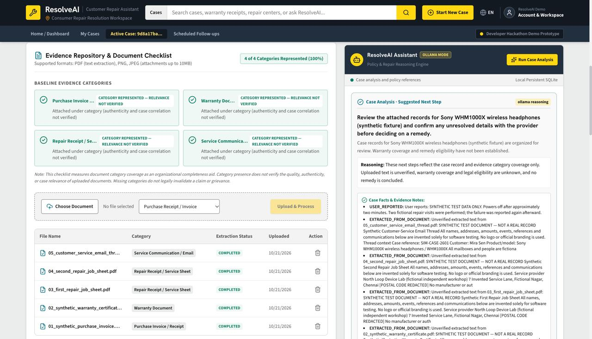

# ResolveAI

> **Personal repair-resolution agent** being developed for the Amazon Developer Hackathon.
> ResolveAI helps consumers manage recurring product-repair problems, starting with a laptop that develops the same fault again after two repair attempts.

---

## Backend — Phases 1 to 6: Core Agentic Workflow & Simulation

This repository contains the backend for ResolveAI, built with **Python**, **FastAPI**, **SQLAlchemy**, and **SQLite**.

### Technology Stack
- **Python**: 3.14+ 
- **FastAPI**: 0.115+
- **Uvicorn**: 0.30+
- **SQLAlchemy**: 2.0+
- **Pydantic**: 2.7+
- **pypdf**: 5.0+ (selectable text extraction from PDFs)
- **python-multipart**: 0.0.9+ (multipart/form-data support)
- **SQLite**: Local persistent storage (default: `backend/data/resolveai.db`)
- **Pytest**: 8.0+

---

## macOS Developer Setup Guide

Follow these simple steps in Terminal on macOS:

### 1. Clone the repository
```bash
go to terminal and enter "git clone "https://github.com/nakshatra-s08/Resolve-AI"
```

### 2. Create and activate a Python virtual environment (recommended)
```bash
python3 -m venv .venv
source .venv/bin/activate
```

### 3. Install dependencies
```bash
pip install -r requirements.txt
```

---

## Running the Application

### 1. Start the FastAPI server
From the `backend/` directory:
```bash
python3 -m uvicorn app.main:app --reload --port 8000
```

The application will start at: `http://127.0.0.1:8000`

### 2. Test the Health Endpoint
In a separate terminal or web browser:
```bash
curl http://127.0.0.1:8000/api/health
```
**Expected Response:**
```json
{"status":"ok"}
```

### 3. Interactive API Documentation
Open your browser to:
- **Swagger UI**: [http://127.0.0.1:8000/docs](http://127.0.0.1:8000/docs)
- **ReDoc**: [http://127.0.0.1:8000/redoc](http://127.0.0.1:8000/redoc)

---

## API Endpoints Overview

| Method | Endpoint | Description |
|---|---|---|
| `GET` | `/api/health` | Confirm backend operational status (`{"status": "ok"}`) |
| `POST` | `/api/cases` | Create a new repair case (initial status: `NEW`, logs `CASE_CREATED`) |
| `GET` | `/api/cases` | List all existing repair cases (ordered newest first) |
| `GET` | `/api/cases/{case_id}` | Retrieve a specific case by its UUID (returns 404 if not found) |
| `PATCH` | `/api/cases/{case_id}` | Partially update case details (`title`, `product_name`, `issue_description`) |
| `PATCH` | `/api/cases/{case_id}/status` | Transition case workflow status (returns 409 on disallowed transitions) |
| `POST` | `/api/cases/{case_id}/events` | Add a manual user note (`event_type: NOTE_ADDED`) to the timeline |
| `GET` | `/api/cases/{case_id}/timeline` | Retrieve chronological timeline events (`skip` & `limit` query parameters supported) |
| `POST` | `/api/cases/{case_id}/evidence` | Upload evidence document/image via `multipart/form-data`, extracts text, logs timeline event |
| `GET` | `/api/cases/{case_id}/evidence` | List all evidence metadata attached to a case (omits heavy text bodies) |
| `GET` | `/api/cases/{case_id}/evidence/{evidence_id}` | Retrieve single evidence metadata with complete extracted text and suggestions |
| `DELETE` | `/api/cases/{case_id}/evidence/{evidence_id}` | Safely remove stored disk file and database metadata; records `EVIDENCE_DELETED` |
| `GET` | `/api/cases/{case_id}/evidence-checklist` | Heuristic checklist comparing existing vs missing document categories |
| `GET` | `/api/policies` | List available policy sources and references without complete text |
| `GET` | `/api/policies/{policy_id}` | Retrieve full policy source text and provenance metadata |
| `POST` | `/api/policies/search` | Search policy library for passages matching query tokens |
| `POST` | `/api/cases/{case_id}/analysis` | Generate structured case-aware analysis and next-step recommendations |
| `POST` | `/api/cases/{case_id}/chat` | Ask questions about a case; returns grounded answers citing case context and policy |
| `POST` | `/api/cases/{case_id}/actions` | Propose an action for a case (initial status: `PENDING_APPROVAL`, requires user approval) |
| `GET` | `/api/cases/{case_id}/actions` | List all proposed, approved, and executed actions for a case |
| `GET` | `/api/cases/{case_id}/follow-ups` | List scheduled follow-ups for a case with real-time `is_overdue` status |
| `GET` | `/api/actions/{action_id}` | Retrieve single action record |
| `PATCH` | `/api/actions/{action_id}` | Edit an action in `DRAFT` or `PENDING_APPROVAL` (invalidates prior approval) |
| `POST` | `/api/actions/{action_id}/approve` | Explicitly approve an action (transitions from `PENDING_APPROVAL` to `APPROVED`) |
| `POST` | `/api/actions/{action_id}/reject` | Explicitly reject an action (transitions to `REJECTED`, permanently blocks execution) |
| `POST` | `/api/actions/{action_id}/execute` | Execute an approved action in a safe simulated environment (idempotent) |
| `POST` | `/api/cases/{case_id}/simulate-response` | Ingest a simulated service provider response and link to case/action |
| `GET` | `/api/cases/{case_id}/responses` | List all simulated provider responses received for a case |
| `POST` | `/api/cases/{case_id}/responses/{response_id}/process` | Analyze a provider response against case evidence and policy, producing findings |

---

## Simulated Provider Responses & Follow-Up Automation (Phase 6)

ResolveAI provides a complete simulated loop from action dispatch to provider response analysis and case reassessment.

### 1. Simulated Provider Response Flow
```
User Approves Action ──► Action Executed (Simulated)
                                │
                                ▼
         POST /api/cases/{case_id}/simulate-response
                                │
                                ▼
         POST /api/cases/{case_id}/responses/{response_id}/process
                                │
                                ▼
  Extract Requests / Commitments / Check Available vs Needed Evidence
                                │
                                ▼
       Case Reassessment & Propose Next Action for Human Approval
```

### 2. Endpoints
- **`POST /api/cases/{case_id}/simulate-response`**:
  Accepts:
  ```json
  {
    "response_text": "We acknowledge your repair complaint. Please upload your second repair receipt/job sheet.",
    "related_action_id": "<action_uuid>",
    "provider_name": "Official Service Center"
  }
  ```
  - Validates that `related_action_id` strictly belongs to the specified case.
  - Automatically transitions an `AWAITING_RESPONSE` case into `UNDER_REVIEW`.
  - Automatically completes/executes any related `SCHEDULE_FOLLOW_UP` action.
  - Adds a `SIMULATED_RESPONSE_RECEIVED` timeline event marked with `source_type: SIMULATION`.

- **`POST /api/cases/{case_id}/responses/{response_id}/process`**:
  Analyzes response contents against attached evidence and policy guidelines.
  Returns:
  - `requested_information`: Identified document or detail inquiries.
  - `evidence_already_available`: Documents requested that already exist in case evidence attachments.
  - `evidence_still_needed`: Documents requested that are not yet provided.
  - `identified_commitments`: Commitments, offers, or deadlines provided by the vendor.
  - `ambiguities`: Non-committal or conditional statements.
  - `suggested_action`: A draft proposed follow-up action (never auto-executed).
  - `suggested_case_status`: Recommended next status transition (`COLLECTING_EVIDENCE` or `UNDER_REVIEW`).
  - Idempotent: repeated calls on a processed response return cached results without creating duplicate timeline events.

---

## Agent Actions & Approval Workflow (Phase 5)

ResolveAI enforces human-in-the-loop control for any consequential action. The AI or system may only propose actions; execution is strictly blocked until explicit user approval is recorded.

### 1. Action Lifecycle State Machine
```
[DRAFT] / [PENDING_APPROVAL] ──(Approve)──► [APPROVED] ──(Execute)──► [EXECUTED]
       │             ▲                          │
       │             └──(Edit invalidates)──────┘
       ▼
   [REJECTED] (permanently blocked)
```

- **Supported Action Types**:
  - `SEND_MESSAGE`: Generates a proposed communication (e.g. escalation notice). Must include `recipient`, `message_body`, and `is_simulated: true`.
  - `SCHEDULE_FOLLOW_UP`: Establishes a reminder. Must include `due_at` (UTC timestamp) and `purpose`.
- **Supported Statuses**: `DRAFT`, `PENDING_APPROVAL`, `APPROVED`, `REJECTED`, `EXECUTED`, `FAILED`, `CANCELLED`.
- **Approval Invalidation**: If an action is edited via `PATCH /api/actions/{action_id}`, any existing approval is automatically revoked and the status returns to `PENDING_APPROVAL`.
- **Execution Guardrails**:
  - Unapproved or rejected actions return `HTTP 409 Conflict` upon execution attempts.
  - The AI model is strictly prohibited from approving actions on the user's behalf.
  - Idempotent execution: Calling execute on an already executed action returns the existing record without duplicating effects.

---

## Policy Retrieval & Case Reasoning (Phase 4)

ResolveAI provides a policy retrieval and case reasoning engine that grounds advice in case facts and reference standards.

### 1. Curated Policy Library & Provenance Rules
The policy library is seeded idempotently on application startup into the `policy_sources` SQLite table. Every source includes its provenance:
- **Illustrative Standards**: Clearly labeled with `DEMO POLICY — NOT AN OFFICIAL MANUFACTURER POLICY` (e.g., replacement escalation thresholds after 2 repair attempts).
- **Reference pointer**: The National Consumer Helpline entry stores a link only. It is classified as general guidance and contains no verified quote or legal rule.
- **Best Practice Evidence Guidelines**: Checklists and guidance for chain-of-custody in repeat repair disputes.

### 2. Lexical Policy Retrieval
- The `PolicyRetrievalService` implements lexical keyword matching with frequency weighting and title boost.
- Breaks policy documents into discrete passages and returns passages with relevance scores.
- Rejects empty queries and returns empty lists for irrelevant queries without fabricating citations.

---

## Evidence Management & Document Processing

### Supported File Formats:
- **PDF** (`.pdf`): Selectable text is extracted using `pypdf`. Image-only/scanned PDFs yield extraction status `NO_TEXT_FOUND`.
- **PNG** (`.png`), **JPG / JPEG** (`.jpg`, `.jpeg`): Supported for document attachments. Returns `UNSUPPORTED` extraction status (OCR is intentionally out of scope).
- **Validation**: Strict file magic header inspection prevents client MIME spoofing (e.g. `.exe` disguised as `.pdf`).

### Maximum File Size:
- Default: **10 MB** (10,485,760 bytes). Configurable via `MAX_UPLOAD_SIZE_BYTES` in `.env`.
- Uploads are streamed in bounded chunks to prevent high memory consumption.

---

## Case Workflow Status Transitions

ResolveAI implements a controlled state machine. Invalid transitions return `HTTP 409 Conflict`.

- **`NEW`** ➔ `COLLECTING_EVIDENCE`, `UNDER_REVIEW`, `CLOSED`
- **`COLLECTING_EVIDENCE`** ➔ `UNDER_REVIEW`, `ACTION_READY`, `CLOSED`
- **`UNDER_REVIEW`** ➔ `COLLECTING_EVIDENCE`, `ACTION_READY`, `RESOLVED`, `CLOSED`
- **`ACTION_READY`** ➔ `COLLECTING_EVIDENCE`, `AWAITING_RESPONSE`, `CLOSED`
- **`AWAITING_RESPONSE`** ➔ `FOLLOW_UP_DUE`, `UNDER_REVIEW`, `COLLECTING_EVIDENCE`, `RESOLVED`, `CLOSED`
- **`FOLLOW_UP_DUE`** ➔ `UNDER_REVIEW`, `COLLECTING_EVIDENCE`, `AWAITING_RESPONSE`, `RESOLVED`, `CLOSED`
- **`RESOLVED`** ➔ `UNDER_REVIEW` (reopened if issue returns), `CLOSED`
- **`CLOSED`** ➔ `UNDER_REVIEW` (reopened if further work required)

---

## Database Storage & Schema Changes

- **Default Location**: `backend/data/resolveai.db` (auto-created on startup).
- **Persistent**: Survives backend restarts.
- **Schema setup**: `init_db()` uses SQLAlchemy `create_all()` to create missing tables. This safely creates the `simulated_responses` table and preserves all existing `cases`, `case_events`, `evidence`, `actions`, and `policy_sources` data without alteration.

---

## Running Automated Tests

Run the full pytest suite from the `backend/` directory:

```bash
python3 -m pytest -v
```

All 73 unit and integration tests run against an **isolated in-memory SQLite database** (`sqlite:///:memory:`) and temporary upload directories.


## Screenshots

### 1. ResolveAI Dashboard


### 2. AI Assistant


### 3. Action Approval and Workflow


### 4. Evidence Timeline


